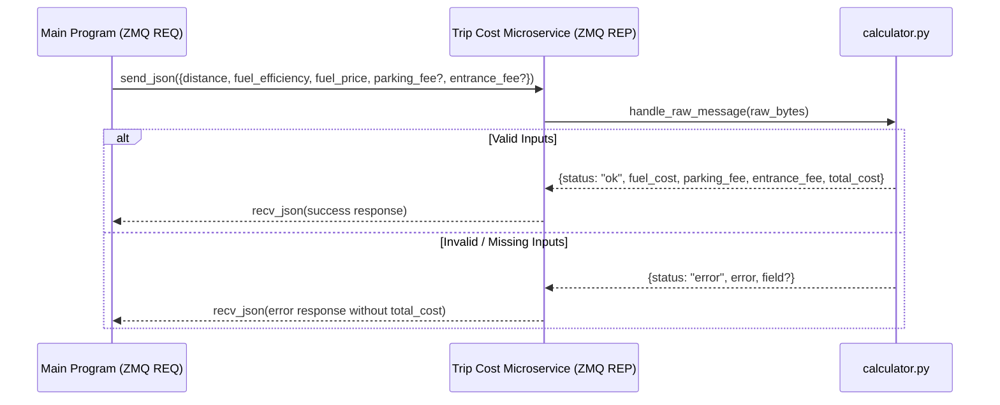

# Trip Cost Estimate Microservice (CS361 — Group 1)

A Python + ZeroMQ (`REQ`/`REP`) microservice that calculates an itemized trip cost estimate from trip distance, vehicle fuel efficiency, fuel price, and optional parking and entrance fees.

## Setup & Running

1. Install dependencies:
   ```bash
   pip install -r requirements.txt
   ```
2. Start the microservice (default endpoint: `tcp://127.0.0.1:5558`):
   ```bash
   python3 server.py
   ```
   You can override the host or port via CLI flags or environment variables:
   ```bash
   python3 server.py --host 127.0.0.1 --port 5558
   # or:
   TRIP_COST_PORT=6000 python3 server.py
   ```
3. Run the example client in a second terminal:
   ```bash
   python3 client_example.py
   ```
4. Run the automated test suite:
   ```bash
   python3 -m unittest discover -v
   ```

---

## Communication Contract

### How to Programmatically REQUEST Data

Connect a ZeroMQ `REQ` socket to `tcp://127.0.0.1:5558` and send a UTF-8 JSON object with the following fields:

| Field | Type | Required | Constraints |
| :--- | :--- | :--- | :--- |
| `distance` | number | Yes | `>= 0` (total trip distance in miles) |
| `fuel_efficiency` | number | Yes | `> 0` (miles per gallon) |
| `fuel_price` | number | Yes | `>= 0` (USD per gallon) |
| `parking_fee` | number | No | `>= 0` (defaults to `0.00` if omitted or `null`) |
| `entrance_fee` | number | No | `>= 0` (defaults to `0.00` if omitted or `null`) |

Example request call in Python:

```python
import zmq

context = zmq.Context()
socket = context.socket(zmq.REQ)
socket.connect("tcp://127.0.0.1:5558")

request = {
    "distance": 100,
    "fuel_efficiency": 25,
    "fuel_price": 3.50,
    "parking_fee": 10.00,
    "entrance_fee": 5.00,
}
socket.send_json(request)
```

### How to Programmatically RECEIVE Data

Call `socket.recv_json()` on the same `REQ` socket to receive the JSON reply:

```python
response = socket.recv_json()
if response["status"] == "ok":
    print(f"Fuel: ${response['fuel_cost']:.2f}")
    print(f"Parking: ${response['parking_fee']:.2f}")
    print(f"Entrance: ${response['entrance_fee']:.2f}")
    print(f"Total: ${response['total_cost']:.2f}")
else:
    print(f"Error ({response.get('field', 'request')}): {response['error']}")
```

#### Success Response Schema

```json
{
  "status": "ok",
  "fuel_cost": 14.0,
  "parking_fee": 10.0,
  "entrance_fee": 5.0,
  "total_cost": 29.0
}
```

- All monetary values are rounded to the nearest cent (`Decimal`, `ROUND_HALF_UP`).
- `total_cost` is guaranteed to equal `fuel_cost + parking_fee + entrance_fee` to the nearest cent.

#### Error Response Schema

```json
{
  "status": "error",
  "error": "Invalid input for 'fuel_efficiency': fuel efficiency must be greater than zero.",
  "field": "fuel_efficiency"
}
```

- Error responses always identify the invalid or missing field (when applicable) and **never** include `total_cost`.

---

## UML Sequence Diagram


